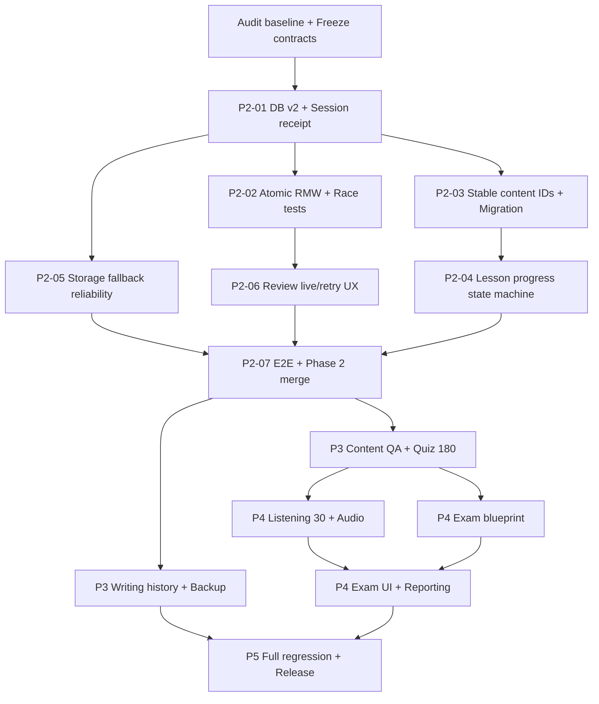

# ON-TAP-TC3 — TECH LEAD REVIEW & MASTER COMPLETION PLAN

**Ngày review:** 2026-10-11 (Asia/Bangkok)  
**Repository:** https://github.com/ManhT005/on-tap-tc3  
**Nhánh được kiểm tra:** `feature/phase-2-learning-core`  
**HEAD:** [`50a4fa788f18e8df1a2593fab49fba68855e0b1f`](https://github.com/ManhT005/on-tap-tc3/commit/50a4fa788f18e8df1a2593fab49fba68855e0b1f)  
**Baseline:** `develop` (`ed0a093797a9483fc7ce89ead143d51616b9a435`); feature ahead **31 commits**, behind **0**.  
**Trạng thái CI HEAD:** **PASS** — [GitHub Actions run 37934804232](https://github.com/ManhT005/on-tap-tc3/actions/runs/37934804232); `validate` và `e2e` đều success.  
**Phương pháp kiểm tra:** Đọc source trực tiếp qua GitHub connector; so sánh commit; đọc workflow run và jobs; không clone/chạy `npm` hoặc Playwright trên máy reviewer (môi trường container không truy cập github.com). Vì vậy, phát hiện từ source được ghi `CONFIRMED-CODE`, còn rủi ro cần test được ghi `VERIFY`.

## 0. QUYẾT ĐỊNH TECH LEAD

- **Giữ kiến trúc hiện có**, không rewrite. `UI → features/hooks → domain → repository → IndexedDB` là hướng hợp lý cho ứng dụng TC3 local-first.
- **Không merge Phase 2 ngay chỉ vì CI xanh.** CI xác nhận các bài test *hiện có* chạy thành công, chưa chứng minh idempotency theo `sessionId`, tính đúng khi hai tab cùng cập nhật SRS, migration, fallback sau khi đã có dữ liệu, và integrity của học liệu.
- **Khóa phạm vi Phase 2:** kết thúc learning loop, độ bền dữ liệu, UX cơ bản và test đối kháng. Listening, Mock Exam và release production chuyển sang phase sau.
- **Hai điểm kết thúc:** (A) `v0.3.0` — Learning MVP đầy đủ, ổn định; (B) `v1.0.0` — 15 bài được QA, Listening/Exam, quản lý dữ liệu, release quality.
- **Ưu tiên tính đúng trước tính mới:** chưa mở rộng SRS hoặc exam bank nếu progress/review identity chưa an toàn.

## 1. BASELINE THỰC TẾ

### 1.1. Đã có

| Thành phần | Evidence/source | Kết luận |
|---|---|---|
| 15 lessons, từ vựng, ngữ pháp | `src/data/`, `src/domain/learning/`, `src/pages/LearnPage.tsx` | Có |
| Lesson flow (Recall → Vocab → Grammar → Quiz) | `src/features/learning/` | Có, progress theo step chưa trung thực |
| Quiz theo bài/tất cả/câu sai | `QuizPractice.tsx` | Có, random sampling đã bổ sung |
| Reading (text/evidence, scoring) | `ReadingPractice.tsx` | Có |
| Writing (self-check; lựa chọn 2 đề/bài) | `WritingPractice.tsx` | Có; **text bài viết không được lưu** (UI có cảnh báo) |
| Spaced repetition Leitner | `src/domain/review/` | Có, còn concurrency/time refresh cần hardening |
| IndexedDB v1, Memory fallback | `src/repositories/` | Có; cần xem xét migrate/khôi phục/khóa phiên |
| Progress dashboard | `ProgressPage.tsx`, repository aggregations | Có |
| CI, unit, E2E smoke | `.github/workflows/ci.yml`, `e2e/app-shell.spec.ts` | **PASS trên HEAD** |

### 1.2. Dữ liệu (theo báo cáo hiện hành trong nhánh)

| Nội dung | Hiện có | Mốc v1 đề xuất | Cần làm |
|---|---:|---:|---:|
| Lesson | 15/15 | 15/15 | QA nội dung và coverage theo từng bài |
| Từ vựng | 1.085 | QA 100% | Stable item IDs; rà soát nghĩa/trùng nghĩa |
| Ngữ pháp | 42 | QA 100% | Ví dụ, hướng dẫn, lỗi phổ biến |
| Quiz | 120/180 | 180 (12/bài) | **+60 câu**, phân bố hợp lý |
| Reading | 39/30 | ≥30 (2/bài) | QA evidence, đáp án và độ khó; không cần thêm số lượng mặc định |
| Writing | 30/30 | 30 (2/bài) | Save draft/answer, self-assessment riêng với điểm khách quan |
| Listening | 0/30 | 30 (2/bài) | **+30 bài và âm thanh có bản quyền rõ ràng** |
| Culture | 15/15 | 15/15 | QA ngôn ngữ/nguồn |

**Chú ý:** Đây là coverage cấu trúc/số lượng, KHÔNG phải kết quả thẩm định chất lượng tiếng Hàn. `docs/data-audit.md` là snapshot Phase 0 đã cũ; số liệu cập nhật nằm tại `docs/content/CONTENT_COVERAGE.md`.

### 1.3. Đã sửa ở commit mới nhất, KHÔNG mở lại như bug chưa làm

- `BUG-P2-001` **partial remediation**: Lesson dùng stable result ID theo mount session, có UI submitting guard; **vẫn chưa có repository-level uniqueness theo sessionId**.
- `BUG-P2-003`: chọn nhiều đề writing trong mỗi lesson.
- `BUG-P2-005`: quiz Fisher–Yates shuffle.
- `BUG-P2-006`: refresh mistakes sau submit.
- `BUG-P2-007`: `AUTO_GRADED` vs `SELF_ASSESSED` cho accuracy.
- `BUG-P2-008`: làm rõ không lưu text viết, không coi là đã triển khai lưu bài viết.
- `BUG-P2-011`: sort recent mistakes theo `lastWrongAt`.
- `BUG-P2-012`: guard thao tác review grade tại UI/hook; cần kiểm tra concurrency dưới lớp dữ liệu.
- CI cho HEAD đã PASS, vì vậy `GATE-P2-015` (chưa có bằng chứng CI) đã được cập nhật thành **VERIFIED-CI**; phần acceptance thủ công vẫn chưa sign-off.

## 2. OPEN FINDINGS — CÓ BẰNG CHỨNG TỪ SOURCE

| ID | Ưu tiên | Trạng thái | Hiện tượng/rủi ro | Nơi sửa |
|---|---|---|---|---|
| CORE-01 | **P0** | CONFIRMED-CODE | `PracticeCompletionCommand` khai báo `sessionId`, nhưng IndexedDB và Memory chỉ kiểm duplicate theo `result.id`; retry same session/new result ID vẫn có thể ghi thêm record. | `progress.repository.ts`, `indexeddb-progress.repository.ts`, `memory-progress.repository.ts`, `progress.database.ts` |
| CORE-02 | **P0** | VERIFY / RISK | ReviewUpdates được tính từ `getReviewItems()` **trước** khi vào transaction ghi. Hai tab có thể ghi đè `repetitions`, `box`, `wrongCount` dù mỗi transaction riêng vẫn atomic. | `complete-practice.ts`, review service, IndexedDB repo |
| CORE-03 | **P1 cao** | CONFIRMED-CODE | `LessonLearningFlow.tsx` vẫn gọi ID theo `packIndex/itemIndex`, không sử dụng `getStableVocabularyReviewId`; reorder data làm lệch review. | `use-lesson-flow.ts`, `LessonLearningFlow.tsx`, content ID/migration |
| CORE-04 | **P1 cao** | CONFIRMED-CODE | Lesson progress vẫn tính mốc 25/50/100, grammar checklist luôn hiển thị hoàn tất; quiz submit có thể đặt `COMPLETED` dù người học chưa học các phần trước. | `use-lesson-flow.ts`, `LessonLearningFlow.tsx`, `complete-practice.ts` |
| CORE-05 | **P1 cao** | CONFIRMED-CODE | Fallback chuyển sang Memory repository mới khi IndexedDB lỗi; không hydrate dữ liệu cũ. UI Progress có warning, nhưng session dữ liệu trước đó vẫn không hiện khi primary fail. | `resilient-progress.repository.ts`, provider, settings/recovery UI |
| CORE-06 | P1 | CONFIRMED-CODE | `use-review-queue.ts` chỉ tải danh sách khi mount; due queue dựa trên `new Date()` mỗi lần render, không có clock tick/visibility/focus refresh. | `use-review-queue.ts` |
| CORE-07 | P1 | CONFIRMED-CODE | `grade()` dùng stale `ReviewStatus`; `setState` guard có thể không chặn hai event cùng tick. `ReviewQueueItem` nhận callback `void` và nút Lưu không bị disable khi đang ghi; chưa có atomic read-modify-write. | review repo/domain/hook |
| CORE-08 | P1 | CONFIRMED-CODE | `WritingPractice` lưu self-assessment, nhưng không persist actual response hoặc draft theo prompt; text bị xóa khi chuyển đề/bài. | writing/types/storage |
| CORE-09 | P1 | CONFIRMED-CODE | Validator chấp nhận MCQ tối thiểu 2 đáp án, authoring guide nói đúng 4; coverage quiz <12 chỉ ở audit/warning, chưa thành release gate; chưa QA ngôn ngữ. | `scripts/validate-content.ts`, `docs/content/` |
| CORE-10 | P2 | CONFIRMED-CODE | Quiz `mistakes` chọn mọi review question item, kể cả đã trả đúng về sau; cần định nghĩa "đã từng sai" vs "đang cần luyện". | `QuizPractice.tsx`, domain filter |
| CORE-11 | P1 | VERIFY / PRODUCT GAP | Bài học/đề đã hoàn thành không lưu trọn lịch sử attempts/answered evidence cho người dùng; cần quy chuẩn danh tính attempts và view history. | practice schema, progress UI |
| CORE-12 | P1 | VERIFY / PRODUCT GAP | Hiện mới có Chrome E2E smoke, chưa có test đầy đủ multi-tab, migration v1→v2, quota, offline asset availability, reopen after deployment. | tests, CI, deployment |

### Hai lỗi nền tảng phải được xử lý đúng cách

**CORE-01:** Chống submit trùng ở UI không phải ràng buộc ở repository. Giải pháp: gắn `sessionId` lên `PracticeResult`/receipt và tạo **unique index** hoặc receipt store với PK = `sessionId` trong cùng transaction. Một session chỉ có một committed receipt; `result.id` khác nhưng `sessionId` bằng nhau vẫn no-op/return original. Viết migration v1→v2 và test lưu qua 2 repo instances.

**CORE-02:** Atomic write ≠ atomic read-modify-write. Nếu tính review updates trên snapshot cũ rồi mới transaction PUT, không đảm bảo không lost update. Di chuyển đọc current review state + kiểm receipt + tính update + ghi result/review/lesson vào một `readwrite` transaction duy nhất; hoặc version/CAS có retry rõ ràng. Không chỉ bổ sung lock React.

## 3. ĐỊNH NGHĨA RELEASE

### Mốc A — Phase 2 CLOSED / Learning MVP v0.3

- 15 bài có thể mở; tối thiểu 8 quiz/bài, reading ≥2/bài, writing ≥2/bài; toàn bộ 15 lessons có learning loop.
- SRS và completed practice thực thi **exactly-once về hiệu ứng lưu**, không sinh duplicate/lost update trong test phù hợp.
- Review ID không đổi khi reorder content sau migration; 0 orphan tạo mới.
- Save/reload/return/retry/degraded đúng thông điệp, không tuyên bố đã lưu vĩnh viễn nếu chỉ ở Memory.
- Lesson progress & checklist phản ánh sự kiện thực thay vì hardcoded.
- CI HEAD xanh **và** manual/UAT checklist đã sign-off.
- Không bắt buộc Listening/Exam để đóng Phase 2; Exam vẫn ghi "Sắp ra mắt" trung thực.

### Mốc B — Product Complete v1.0

- Đủ 15 bài QA; quiz ≥12/bài; Reading & Writing QA; Listening ≥2/bài + audio/subtitle/transcript đáp ứng nguồn hợp lệ.
- Có mock exam cấu hình blueprint, timer, submit, chấm khách quan, result review, persistence.
- Có history luyện tập, export/import backup, reset có xác nhận, giải thích rõ storage/local privacy.
- Responsive, accessibility, performance budgets, browser compatibility, deployment SPA và rollback plan được nghiệm thu.
- Không gọi Writing là "AI grading" nếu chỉ keyword checklist + tự đánh giá.

## 4. WORKSTREAM / TASK BREAKDOWN CÓ THỂ GIAO DEV

**Mô hình:** Dev A (domain/repository/testing), Dev B (feature/UI/E2E), QA/Tech Lead kiểm tra chéo; Content reviewer tiếng Hàn tách khỏi kỹ thuật. Không giao hai dev sửa cùng core contracts trước khi freeze.

### PHASE 2 HARDENING — ưu tiên bắt buộc

#### TC3-P2-01 — Contract & DB Migration v2 [P0, Dev A]

**Mục tiêu:** explicit session identity và migration không phá progress hiện hữu.

- [ ] Quyết định versioned schema: `PracticeResult.sessionId`, `assessmentType`, `contentVersion`, `completedAt`.
- [ ] Unique `by-session-id` trong IndexedDB v2 **hoặc** `completion_receipts` store keyed sessionId; không phá dữ liệu v1.
- [ ] Upgrade v1→v2 idempotent; với records lịch sử thiếu sessionId, giữ nguyên, không tự suy diễn nếu không thể xác nhận.
- [ ] Cập nhật `ProgressRepository.commitPracticeCompletion` contract để duplicate có thể trả existing result/receipt.
- [ ] Memory adapter tuân thủ cùng semantics; tests cả hai adapters.
- [ ] Failure migration/quota báo lỗi có thể recover; không tự xóa DB.

**Acceptance:** same session/different result ID chỉ tạo **1** record và 1 lần review mutation; 2 sessions khác nhau đều được lưu; reopen DB còn dữ liệu cũ.

**Tests:** `TC-DB-01..06`: v1→v2, duplicate ID, duplicate session with changed ID, parallel commits, failed upgrade, cross-instance reopen.

#### TC3-P2-02 — Atomic RMW for review and completion [P0, Dev A]

- [ ] Thay precomputed stale ReviewStatus bằng events/commands (`sessionId`, `answers`, `questionIds`, `gradedAt`) hoặc transaction updater nhận current stored state.
- [ ] Đọc receipt + review item current + cập nhật Review/lesson trong **một** IDB readwrite tx.
- [ ] Định nghĩa lock scope/session key khi hai tabs cùng grade một item.
- [ ] Chính sách trùng event và retry sau lỗi giữa chừng; không làm tăng `wrongCount`/`repetitions` 2 lần.
- [ ] Dùng injected clock trong domain để test time boundary.

**Acceptance:** hai session khác nhau hoàn thành gần đồng thời vẫn giữ tổng counter đúng; failed transaction rollback toàn bộ; replay cùng session không nhân đôi.

**Tests:** `TC-RACE-01..05`, `TC-TX-01..04`, fake-indexeddb + hai repo instances; browser two-context integration bổ sung nếu khả thi.

#### TC3-P2-03 — Stable content/review identity [P1, Dev A + Content, sau P2-01]

- [ ] Gắn **immutable ID** cho vocabulary/grammar item trong content schema. Không lấy index, vị trí pack hoặc text động làm danh tính lâu dài.
- [ ] Nếu tạm dùng word-encoded ID, xác minh duplicate word cùng lesson, đổi chính tả/đồng âm/trùng nghĩa; ưu tiên stable explicit `vocabId`.
- [ ] `LessonLearningFlow` dùng identity mới cho Recall và Vocabulary; thống nhất với `getReviewPrompt`.
- [ ] Migration mapping legacy `lesson-N-vocabulary-packIndex-itemIndex` → stable ID theo snapshot hiện tại, xử lý collision/orphan; versioned migration.
- [ ] Có lệnh audit orphan & duplicate IDs và fixture đảo thứ tự bài/từ.

**Acceptance:** reorder content không thay item/review count; reload cũ không mất review; item không match hiển thị recovery rõ, không im lặng xóa.

#### TC3-P2-04 — Progress state machine thật [P1, Dev B, sau contract P2-01]

- [ ] Viết pure function `calculateLessonProgress` từ các sự kiện: `opened`, `recallDone`, `vocabReviewed`, `grammarViewed/checked`, `quickQuizCompleted`.
- [ ] Quyết định trọng số/tỷ lệ và DoD (vd: tất cả mục bắt buộc + quiz submitted); phân biệt COMPLETED vs quiz-completed.
- [ ] Grammar checklist không auto `✅` nếu không có action thật; tránh game hóa giả.
- [ ] Persist/resume step-specific state khi reload, chuyển lesson và back; update monotonic ở flow hiện hành.
- [ ] Button Complete disable trong `submitting`, thông báo lỗi & retry.

**Acceptance:** chỉ mở bài không thành 25% tiến độ thực nếu không có step; đánh dấu một từ không tự thành 50% vô căn cứ; học chưa đủ không thành 100%; reload giữ đúng state.

#### TC3-P2-05 — Storage/fallback safety [P1 cao, Dev A]

- [ ] Chốt chiến lược **không mất dữ liệu âm thầm**: ưu tiên fail-closed cho persistent writes + Retry; memory-only chỉ là explicit degraded mode, có nhãn "chưa lưu lâu dài".
- [ ] Nếu cho phép memory-mode, phải có snapshot/export tạm và cơ chế reconcile rõ ràng khi storage phục hồi; **không** tự merge 2 bộ dữ liệu trùng.
- [ ] Phân biệt IndexedDB unavailable trước first read vs fail sau khi có data; không hiện tổng 0 như xác nhận chưa học.
- [ ] Expose `StorageHealth`, recover/retry operation, last persisted timestamp; warning từ mọi trang nơi action cần lưu.
- [ ] Test offline/private browsing/quota/blocked DB/versionchange.

**Acceptance:** không hiển thị kết quả phiên ephemeral như dữ liệu durable; không mất dữ liệu đã lưu trước đó do fallback trắng; recovery state rõ.

#### TC3-P2-06 — Review live clock & concurrency [P1, Dev B + Dev A]

- [ ] Refresh due queue khi `visibilitychange`, focus, và timer hợp lý; cleanup listeners/timers.
- [ ] Kiểm tra item đến hạn mà trang đang mở không refresh; update counter dashboard phù hợp.
- [ ] Đổi `onGrade` thành `() => Promise<void>` hoặc truyền `isSubmitting`, disable nút Lưu/khoá confidence trong khi ghi; dùng ref/mutex theo key (không chỉ `useState`), repository guards vẫn là nguồn sự thật.
- [ ] Rà soát orphan banner; orphan không được tính như item có thể tương tác và cần có dòng thống kê rõ.
- [ ] Giải thích/filter "đã từng sai" vs "cần ôn lại" nhất quán.

**Acceptance:** item đến hạn hiển thị sau clock tick/focus, không duplicate grade và số hiển thị thống nhất.

#### TC3-P2-07 — Regression/UAT & merge [P0 gate, QA + cả team]

- [ ] Unit domain+repo concurrency/migration/error tests theo mục 8.
- [ ] E2E toàn luồng Lessons 01/08/15, reload, review grade, session retry, writing prompt selector, Reading, responsive.
- [ ] Manual two-tabs, IndexedDB unavailable, quota, reload, browser back/forward.
- [ ] CI trên **commit cuối** green, reviewer sign-off và bug P0/P1 hợp scope đóng.
- [ ] Freeze Phase 2 và PR `feature/phase-2-learning-core` → `develop` (không nhảy thẳng main).

### PHASE 3 — CONTENT & STUDY EXPERIENCE

#### TC3-P3-01 — Content governance & validators [P0, Dev A + Content QA]

- [ ] Dùng authoring schema Zod duy nhất cho lesson/quiz/reading/writing/listening; không duplicate quy định giữa script & guide.
- [ ] Đúng **4** options với MCQ nếu vẫn là requirement; correctIndex 0..3; distinct nonblank distractors; explanation/evidence.
- [ ] Coverage gate 15 lessons, ≥12 quiz, ≥2 Reading, ≥2 Writing mỗi bài; warning khác fail rõ ràng.
- [ ] Detect duplicate immutable content IDs, dangling question refs, orphan review IDs, empty Korean text, duplicate answers.
- [ ] Sinh `CONTENT_COVERAGE.md` bằng CI + diff; khóa xuất bản nếu phủ thiếu; mẫu content approval log.
- [ ] Reviewer tiếng Hàn kiểm >= 100% đáp án đúng và giải thích; xác nhận nguồn/bản quyền.

#### TC3-P3-02 — Enrich quiz bank [P1, Content QA + Dev B]

- [ ] Bổ sung **60 câu** (4 câu x 15 bài) nâng 8→12/bài.
- [ ] Phân bổ vocabulary/grammar, tránh học thuộc vị trí đáp án; distractor tự nhiên.
- [ ] Có giải thích chuẩn tiếng Việt, tag kỹ năng/độ khó và stable ID.
- [ ] Test mỗi câu chỉ có một đáp án đúng, code validator không thể tự kiểm tính đúng nghĩa => human-review sign-off.

#### TC3-P3-03 — Writing drafts & history [P1, Dev A + Dev B]

- [ ] Lưu draft theo `lessonId + promptId`; autosave debounced và trạng thái lưu an toàn.
- [ ] Lưu submitted answer theo attempt; model answer chỉ hiện sau nộp hoặc sau hành động xác nhận.
- [ ] Tách self-assessment khỏi `accuracy`; không hiển thị như chấm AI.
- [ ] Export/import được writing drafts/history.
- [ ] Clear/reset chỉ sau xác nhận; test giữ bài khi chuyển đề, reload, lỗi lưu.

#### TC3-P3-04 — UX, history, progress insights [P1, Dev B]

- [ ] Practice history theo mode, lesson, ngày, điểm, kết quả; trang xem lại bài đã làm.
- [ ] Error/empty/loading states nhất quán; Resume Last Lesson, Continue Review.
- [ ] Phân biệt due, new, learned, mastered; hiển thị ngày ôn kế tiếp.
- [ ] Keyboard navigation, ARIA live message, contrast, mobile 360/390/430/768.
- [ ] Không biến thống kê đơn giản thành "mastery" không có công thức giải thích.

#### TC3-P3-05 — Backup, restore & privacy [P1, Dev A]

- [ ] Export `.json` chứa schemaVersion, exportedAt, metadata + records cần thiết; không chứa secrets.
- [ ] Import validate schema, preview counts, chính sách merge/replace, backup before destructive replace.
- [ ] Migrate backup version tương thích; bảo vệ file sai/malicious/oversized; limit.
- [ ] Reset từng bài/ toàn bộ với double confirmation; khả năng khôi phục từ backup.
- [ ] Nêu rõ: local-first = dữ liệu lưu trên trình duyệt hiện tại; **không tự đồng bộ giữa các máy**.

### PHASE 4 — LISTENING & EXAM

#### TC3-P4-01 — Listening content contract [P0, Dev A + Content]

- [ ] Schema `ListeningPassage` (id, lessonId, audioUrl, duration, transcript, translation, questions, answers, evidence, rights/source).
- [ ] Tạo **30 listening passages** (2/bài), audio hợp pháp, chuẩn hóa loudness/codec, tải đủ metadata.
- [ ] Cho phép custom playback speed 0.75/1/1.25x, replay, transcript reveal tùy chế độ.
- [ ] Quiz nghe chấm khách quan, answer explanation; review question IDs nối SRS.
- [ ] Offline/deployment asset policy: CDN vs bundling có kiểm tra cache/version; nếu yêu cầu chạy offline đầy đủ phải chủ động cache audio hoặc cung cấp download.

#### TC3-P4-02 — Listening UI & tests [P1, Dev B]

- [ ] Chọn lesson/passage, player có keyboard + captions/transcript, loading/failure/retry.
- [ ] Câu hỏi có trạng thái làm bài, tính điểm, persist attempts.
- [ ] Không phụ thuộc autoplay (bị trình duyệt hạn chế); audio UX cho mobile.
- [ ] E2E mock network failure, playable audio fixture và user recovery.

#### TC3-P4-03 — Exam blueprint & scoring [P0, Dev A]

- [ ] Versioned `ExamBlueprint`: sections (vocab/grammar, reading, listening theo dataset), số câu/thời lượng/độ khó, seed, eligibility.
- [ ] Random no duplicate per attempt, nguồn câu stable IDs, snapshot câu vào attempt để đổi ngân hàng không phá grading lịch sử.
- [ ] Domain state machine: CREATED → IN_PROGRESS → SUBMITTED / EXPIRED / ABANDONED; timer deadline immutable.
- [ ] Auto-scoring cho MCQ; Writing nếu thêm vào đề thi phải self-assessment/manual và báo điểm tách biệt.
- [ ] Persistence exam attempt, recovery khi reload, timeout guard, anti double submit, answer reveal sau nộp.
- [ ] Cân đối ngân hàng 180 quiz/39 Reading/30 Listening đủ số câu cho blueprint định nghĩa; không tuyên bố mô phỏng TOPIK chuẩn khi chưa QA blueprint.

#### TC3-P4-04 — Exam UI + reporting [P1, Dev B]

- [ ] Mode practice vs timed mock, hướng dẫn, timer, navigator câu, flag/revisit.
- [ ] Submit confirm, auto-submit khi hết giờ, progress/remaining time, offline/reload recovery.
- [ ] Result breakdown theo section/lesson/sai đúng; xem explanation, retry một đề mới.
- [ ] E2E dùng fake clock; test refresh giữa thi, expiry, double-submit, empty bank, keyboard/mobile.

### PHASE 5 — RELEASE HARDENING & DELIVERY

#### TC3-P5-01 — Performance & accessibility [P1, Dev B]

- [ ] Kiểm tra web vitals/lighthouse trên build production; đặt budget **đề xuất** LCP <2.5s trên test profile thống nhất, CLS <0.1, không long task rõ rệt.
- [ ] Code split theo route, lazy page/render danh sách dài, content import chunking.
- [ ] WCAG 2.2 AA mục tiêu: keyboard-only, focus, labels, semantics, contrast, screen reader smoke.
- [ ] QA responsive desktop/mobile/tablet; in-app font Hangul và tiếng Việt hiển thị chuẩn.

#### TC3-P5-02 — Data durability, privacy & security [P0, Dev A]

- [ ] Test IndexedDB migrations/backup cross-version; quota exceeded, storage blocked, fail/recover.
- [ ] XSS-safe content rendering, React escaping, không inject raw HTML vào question explanations không kiểm soát.
- [ ] CSP phù hợp deployment, dependency audit, nguồn audio và asset licensing; rà soát accessibility.
- [ ] Nếu yêu cầu chạy **offline thật**: PWA service worker + cache versioning, offline-first navigation fallback, update prompt. Chưa được xem như DONE chỉ vì IndexedDB local.
- [ ] Tài liệu dữ liệu cá nhân: local storage, export/import, xóa, hạn chế khi clearing browser data.

#### TC3-P5-03 — CI/CD & deployment [P0, Tech Lead + Dev A]

- [ ] Branch protection yêu cầu jobs `validate`, `e2e`, no direct pushes lên `main` khi release.
- [ ] Bổ sung coverage reporting, E2E Chromium+Firefox (WebKit tùy target), smoke accessibility.
- [ ] Deploy static SPA có rewrite tất cả non-asset routes → `index.html`; test `/learn/15`, `/review`, `/progress` khi direct/reload.
- [ ] Production asset base path/caching, rollback artifact, version banner, release changelog.
- [ ] Không deploy với storage migration không có backup/recovery strategy.

#### TC3-P5-04 — Final UAT & release [P0, QA/Tech Lead]

- [ ] Dữ liệu 15/15 bài QA; 180 quiz / ≥30 reading / 30 writing / 30 listening.
- [ ] 0 open P0, 0 open P1 blocker; các P2 có quyết định chấp nhận được ghi rõ.
- [ ] E2E golden path: first use → learn → submit wrong → due → review → progress → reload → backup → restore → exam.
- [ ] Test 3 browser profiles, mobile 360/390/430, 2-tab race, downgraded storage, interrupted exams.
- [ ] Bản hướng dẫn người dùng, architecture/ADRs, runbook release, known limitations; tag `v1.0.0` sau khi sign-off.

## 5. THỨ TỰ PHỤ THUỘC — KHÔNG TẠO PR LỘN XỘN



## 6. BRANCH/PR PLAN — ĐỀ XUẤT CHO 2 DEV

Không tạo PR song song ghi vào cùng file repository contract. Có thể làm theo các nhánh tích hợp sau:

| Thứ tự | Branch gợi ý | PR base | Owner | Gate |
|---|---|---|---|---|
| 1 | `fix/p2-storage-session-identity` | `feature/phase-2-learning-core` | A | unique session + migration tests |
| 2 | `fix/p2-review-transaction-race` | `feature/phase-2-learning-core` sau #1 | A | no lost review updates |
| 3 | `fix/p2-stable-review-ids` | `feature/phase-2-learning-core` sau #1 | A+Content | reorder migration |
| 4 | `feat/p2-lesson-progress-state` | `feature/phase-2-learning-core` sau contract freeze | B | real checklist + resume |
| 5 | `fix/p2-storage-recovery` | `feature/phase-2-learning-core` | A | fail-closed/recovery |
| 6 | `fix/p2-review-live-ux-e2e` | `feature/phase-2-learning-core` | B | time due + grade UX + E2E |
| 7 | `feature/phase-2-learning-core` | `develop` | Lead | CI green + review + UAT |
| 8 | `feature/phase-3-content-experience` | `develop` | A+B+Content | 180 quiz + QA + backup/history |
| 9 | `feature/phase-4-listening-exam` | `develop` | A+B | 30 listening, exam scoring/report |
| 10 | `release/v1.0.0` | `main` theo release policy | Lead | production regression + sign-off |

**PR policy:** mỗi PR gắn ID task, summary, impacted data schema, reproduction/test commands, screenshots nếu UI, acceptance checklist và migration note. Không squash mất liên kết issue/commit nếu team cần audit. Sau merge vào `develop`, chạy lại tests trên integration HEAD (khác với feature HEAD).

## 7. ESTIMATION & PHÂN CÔNG

*Ước tính sơ bộ theo dev-days (ngày làm việc), không phải deadline cam kết; review tiếng Hàn/audio phụ thuộc thời gian cung cấp nội dung. Hai dev có thể parallel phần UI và content sau contract freeze.*

| Wave | Phạm vi | Dev A | Dev B | Content/QA | Exit condition |
|---|---|---:|---:|---|---|
| W0 | DB receipt, atomic RMW, migration | 3–5d | 0–1d | test edge cases | Session exactly-once, no lost update |
| W1 | Stable IDs, lesson state, storage recovery, due queue | 3–5d | 3–5d | cross-review | All Phase 2 gates green |
| W2 | Content validator, +60 Quiz, Writing drafts/history, backup | 3–5d | 3–5d | **2–6d+** content review | v0.3 stable & content normalized |
| W3 | Listening 30 / audio + Exam domain/UI | 4–7d | 4–7d | **audio production/review separate** | End-to-end mock exams |
| W4 | Security, a11y, cross-browser, deploy, UAT | 2–4d | 2–4d | 2–3d QA | v1.0 acceptance signed |

Các task content/audio không thể suy từ tốc độ coding; nên có checklist riêng từng bài để biết số lượng **thực sự được review**.

## 8. QA TEST MATRIX — TỐI THIỂU CẦN THÊM

| Test ID | Scope | Điều kiện | Expected |
|---|---|---|---|
| TC-IDEM-01 | Repo | same sessionId/resultId | no duplicate result/review |
| TC-IDEM-02 | Repo | same sessionId, **different resultId** | no duplicate |
| TC-IDEM-03 | Repo | concurrent same-session calls, 2 instances | one receipt, one effect |
| TC-IDEM-04 | Repo | 2 different sessions, same question | both effects applied |
| TC-TX-01 | Repo | injected failure during review update | full rollback |
| TC-TX-02 | Repo | duplicate after successful commit | no-op/return existing |
| TC-RACE-01 | Browser | 2 tabs grade same review item | defined serialized behavior, no silent lost update |
| TC-RACE-02 | Browser | quiz submit and review grade simultaneous | consistent counters/boxes |
| TC-DB-01 | Migration | v1 data reopen as v2 | all old data preserved |
| TC-DB-02 | Migration | repeated database reopen | no record duplication |
| TC-DB-03 | Recovery | quota/storage failure before first read | correct unavailable/degraded message |
| TC-DB-04 | Recovery | failure after previous successful writes | no false zero progress |
| TC-ID-01 | Domain | reorder vocab packs/items | existing review attaches to same item |
| TC-ID-02 | Domain | duplicated kr word with distinct meaning | distinct item identity |
| TC-LESSON-01 | UI | open lesson only | correct early-state progress |
| TC-LESSON-02 | UI | quiz submit without prereq steps | completion follows documented rule |
| TC-LESSON-03 | E2E | reload midway lesson | persisted checklist/state |
| TC-REVIEW-01 | E2E | due time passes while Review open | item appears without navigation |
| TC-REVIEW-02 | UI | double-click grade | one write, correct UI state |
| TC-CONTENT-01 | Script | MCQ with 2 or 5 options | fails if exactly 4 required |
| TC-CONTENT-02 | Script | orphan/malformed ID / invalid evidence | script fails with actionable error |
| TC-WRITE-01 | E2E | edit draft, change prompt, reload | same text restored |
| TC-WRITE-02 | Domain | self-rated writing | objective accuracy unchanged |
| TC-EXAM-01 | Domain | seeded exam construction | no duplicate IDs, blueprint satisfied |
| TC-EXAM-02 | E2E | reload midway timed exam | deadline/answers preserved |
| TC-EXAM-03 | E2E | time expires, double-submit | single result |
| TC-LISTEN-01 | E2E | audio load failure | retry + user feedback |
| TC-BACKUP-01 | Integration | export/import v1/v2 | validated restoration, no corruption |
| TC-DEPLOY-01 | Smoke | direct `/learn/15` + refresh on production | SPA route works |
| TC-MOBILE-01 | E2E | 360/390/430 widths | no horizontal overflow, readable taps |

**Coverage policy:** quan trọng hơn % line coverage: branch critical domain/repository và mọi data migration đều phải có positive/negative tests; E2E không thể chỉ test route navigation.

## 9. LOCAL VERIFICATION COMMANDS

```bash
# PowerShell / CMD / Bash
# Checkout exact HEAD before starting fixes
git fetch origin
git switch feature/phase-2-learning-core
git pull --ff-only origin feature/phase-2-learning-core

node --version
npm ci
npm run typecheck
npm run lint
npm run format:check
npm test
npm run validate:content
npm run audit:data
npm run build
npx playwright install chromium
npm run test:e2e
```

Recommended complementary commands after implementation:

```bash
# Running app in prod-like preview for manual UX, deep-link check
npm run build
npx vite preview --host 127.0.0.1

# Inspect branch difference before merge
git diff --stat origin/develop...HEAD
```

**Manual QA script:** mở bài 1 → mark vocab → grammar action → quiz chọn sai → submit → verify Progress → reload → Review (fake time due) → grade → open second tab → check consistency → switch Writing prompt/save draft → backup/export/import → Exam practice/timed after Phase 4.

## 10. PHASE EXIT GATES (STOP / GO)

### Gate G2 — merge Phase 2 → develop

- [ ] TC3-P2-01..07 closed, tested, reviewed.
- [ ] No P0 unresolved, P1 accepted only with explicit product decision.
- [ ] Migration test v1→v2 + data preservation evidence.
- [ ] Exactly-once receipt + concurrency tests pass.
- [ ] Review ID mapping passes reorder scenario.
- [ ] Complete lesson+review+progress+reload for multiple lessons.
- [ ] CI green on PR HEAD **and** integration HEAD after merge.
- [ ] Manual QA sign-off, change log, rollback data caveat.

### Gate G3 — v0.3 Learning MVP

- [ ] 15 lessons usable, all existing practice modes usable.
- [ ] Content validated; at least baseline 8 quiz/bài, 2 reading/bài, 2 writing/bài; P3 quiz expansion to 12/bài before final content freeze.
- [ ] Export/import, Writing history/draft, degraded warnings validated if included in declared v0.3 scope.
- [ ] Deploy preview smoke + docs updated; no known data corruption defect.

### Gate G4 — feature complete (Listening & Exam)

- [ ] 30 audio/listening passages with rights metadata, playback and answers.
- [ ] Exam blueprint, timer, persistence, scoring and reporting.
- [ ] User can finish a mock exam and revisit results after reload.
- [ ] No accidental mixing of self-assessed Writing into objective accuracy.

### Gate G5 — release v1.0

- [ ] Content reviewer signs 15/15 lessons and all objective answers.
- [ ] Regression entire golden path, tests across supported browsers/devices.
- [ ] Data export/restore, migration, recovery, accessibility, license/privacy checks PASS.
- [ ] Production preview and deep links pass, rollback documented.
- [ ] CI/CD evidence, release notes, tag v1.0.0 and handoff docs.

## 11. RISK REGISTER

| Risk | Severity | Mitigation/owner |
|---|---|---|
| Changed IDs orphan old review progress | Critical | Stable immutable IDs + migration fixture (Dev A + QA) |
| Concurrent tabs cause lost SRS updates | Critical | Transactional RMW/receipt (Dev A) |
| Memory fallback looks like permanent save | High | Explicit warning/opt-in recovery or fail closed (Dev A/B) |
| Audio assets copyright / large bundle | High | Rights/source register, compression, hosting/caching policy (Content + Lead) |
| Quiz numbers good but grammar answers wrong | High | Content sign-off by competent Korean reviewer |
| Browser storage cleared | Medium | Backup/export and user explanation |
| Exam clocks reset after refresh | High | Persist immutable deadline and recovery (Dev A) |
| Scope creep AI grading/account sync | Medium | Excluded from v1 unless separate product decision |
| Incompatible old audit vs current coverage | Low | Generate coverage from source of truth only |

## 12. NHỮNG THỨ KHÔNG CẦN THÊM VÀO V1 THEO MẶC ĐỊNH

- Backend + account authentication + cloud sync (sản phẩm hiện là local-first); có thể đưa vào v1.1 nếu có nhu cầu multi-device.
- AI chấm viết/chữa phát âm chưa có evaluation & privacy design, không nên gắn để "đủ tính năng".
- Hệ thống game hóa lớn, leaderboard, social/login; tránh scope creep.
- Full PWA offline audio nếu chưa có explicit offline requirement và asset budget; cần quyết định product rõ trước release (nhưng không được tuyên bố app chạy offline hoàn toàn nếu chưa có service worker).

## 13. DELIVERABLES CẦN BÀN GIAO

- Source + PRs + branch history clean, architecture diagram & ADRs.
- `docs/phase_2/PHASE_2_CLOSURE_REPORT.md` ghi PASS/FAIL với test evidence.
- `docs/content/CONTENT_COVERAGE.md`, content approval tracker, source/license registry.
- `docs/qa/TEST_MATRIX.md`, `docs/qa/REGRESSION_REPORT.md`, `docs/qa/UAT_SIGNOFF.md`.
- `docs/release/DEPLOYMENT_RUNBOOK.md`, `docs/release/DATA_MIGRATION_AND_BACKUP.md`, `CHANGELOG.md`.
- User guide (how to study/review, how progress is stored/exported) + production deployment and release tag.

## 14. EVIDENCE LINKS

- Branch source: https://github.com/ManhT005/on-tap-tc3/tree/feature/phase-2-learning-core
- CI green HEAD: https://github.com/ManhT005/on-tap-tc3/actions/runs/37934804232
- Latest remediation commit: https://github.com/ManhT005/on-tap-tc3/commit/50a4fa788f18e8df1a2593fab49fba68855e0b1f
- Prior bug audit: https://github.com/ManhT005/on-tap-tc3/blob/feature/phase-2-learning-core/docs/phase_2/ON_TAP_TC3_PHASE2_BUG_FIX_BACKLOG_2026-10-09.md
- Prior phase plan: https://github.com/ManhT005/on-tap-tc3/blob/feature/phase-2-learning-core/docs/phase_2/ON_TAP_TC3_PHASE_2_DEVELOPMENT_PLAN.md
- Current content audit: https://github.com/ManhT005/on-tap-tc3/blob/feature/phase-2-learning-core/docs/content/CONTENT_COVERAGE.md
- Atomic practice implementation: https://github.com/ManhT005/on-tap-tc3/blob/feature/phase-2-learning-core/src/domain/practice/complete-practice.ts
- IndexedDB transaction: https://github.com/ManhT005/on-tap-tc3/blob/feature/phase-2-learning-core/src/repositories/indexeddb/indexeddb-progress.repository.ts
- Stable ID usage: https://github.com/ManhT005/on-tap-tc3/blob/feature/phase-2-learning-core/src/features/learning/components/LessonLearningFlow.tsx

---
**Recommendation sign-off:** Hoàn thành Gate G2 trước; tuyệt đối không dựa vào việc CI hiện xanh để kết luận P2 already DONE. Sau G2, song song chuẩn hóa nội dung và làm tính năng v1, nhưng giữ schema/review ID ổn định trong suốt content expansion.
